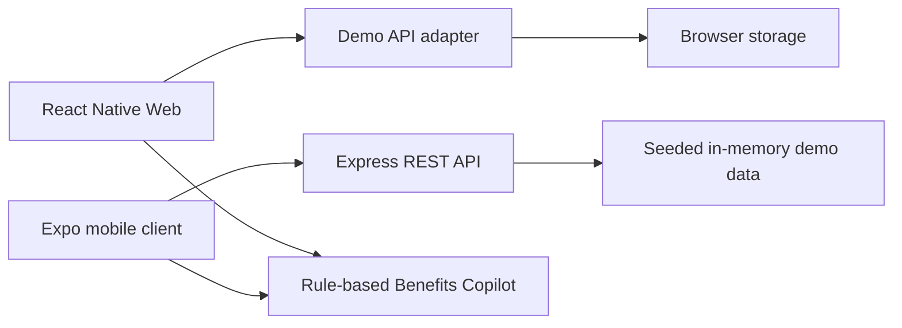

# PayPulse AI

**Short description:** A cross-platform employee benefits and earned wage access demo for employees and HR teams.

PayPulse AI brings earned wage visibility, simulated wage advances, expense reimbursements, payroll details, and HR claim review into one responsive application. It includes a rule-based Benefits Copilot that answers questions using the current demo workspace.

## Project links

- **Live application:** [dist-three-kappa-22.vercel.app](https://dist-three-kappa-22.vercel.app)
- **API health:** [dist-three-kappa-22.vercel.app/api/health](https://dist-three-kappa-22.vercel.app/api/health)
- **Source repository:** [github.com/SrijanSingh2006/paypulse-ai](https://github.com/SrijanSingh2006/paypulse-ai)
- **GitHub profile:** [SrijanSingh2006](https://github.com/SrijanSingh2006)

## What the application does

- **Earned wage access (EWA):** Shows daily wage accrual, the eligible advance cap, simulated advances, and a transaction ledger.
- **Expense management:** Submits categorized claims with optional receipts, tracks allowance use, and lets HR managers review pending claims.
- **Payroll workspace:** Provides role-specific wage summaries, payslip breakdowns, and an in-app notification center.
- **Benefits Copilot:** Answers wage, payslip, EdTech allowance, and expense policy questions using a rule-based response engine.
- **Employee and manager roles:** Switch between employee and HR manager workspaces to explore role-specific views and actions.
- **Responsive interface:** Uses React Native Web and mobile layouts for browser and Expo clients.

## Tech stack

| Layer | Technologies |
| --- | --- |
| Mobile and web client | React Native, React Native Web, Expo SDK 52, TypeScript |
| Navigation and UI | React Navigation, Expo vector icons, responsive React Native components |
| Client state and persistence | Context API, AsyncStorage, browser storage for the hosted demo |
| Backend | Node.js, Express, TypeScript, REST API |
| Authentication | JWT demo authentication and role-based access control (RBAC) |
| Deployment and delivery | Vercel, GitHub Actions CI, Expo Application Services (EAS) build profiles |

## Architecture



The hosted web demo persists its workspace in browser storage. Its public `/api` path is proxied to the Express API deployment. The API uses seeded in-memory data, so its state can reset when a serverless instance restarts.

## Demo scope

This is a portfolio demo using sample data. Wage advances and reimbursements are simulations; no money moves and no real payroll or banking accounts are connected. The Copilot is rule-based and does not call a hosted language model.

## Run locally

Requirements: Node.js 20 or newer and npm.

```bash
npm ci
npm ci --prefix backend
npm ci --prefix mobile
npm run dev
```

`npm run dev` starts the Express API on port 4000 and Expo. Press `w` in the Expo terminal to open the web client. To start only the web client:

```bash
npm run start:web
```

The local API health endpoint is `http://localhost:4000/api/health`.

## Demo roles

The app opens as the employee on a fresh install. Use the header role switcher or Profile tab to switch roles.

| Role | Email | Password |
| --- | --- | --- |
| Employee · Alex Rivera | `employee@heftin.ai` | `password123` |
| HR manager · Sarah Chen | `manager@heftin.ai` | `password123` |

## API surface

- `/api/auth` — demo login, profile, and role switching
- `/api/ewa` — wage summary, advance simulation, and transaction history
- `/api/expenses` — claim submission, filters, statistics, and manager review
- `/api/notifications` — in-app notifications and read state
- `/api/payslips` — seeded payroll breakdowns
- `/api/release` — demo build information
- `/api/ai` — rule-based Benefits Copilot

## Build and verification

```bash
npm run typecheck
npm run build:backend
npm run build:web
```

The GitHub Actions workflow checks the mobile TypeScript build and compiles the backend. EAS preview and production profiles are included in `mobile/eas.json`; store signing credentials and published Android/iOS builds are not included.

## Resume-ready description

Built and deployed PayPulse AI, a responsive React Native and Expo employee benefits platform backed by a TypeScript and Express REST API. Implemented earned wage accrual and eligibility rules, JWT authentication and RBAC demo flows, expense claim submission with optional receipts, HR review workflows, role-specific payroll and payslips, browser-persisted demo state, and a rule-based Benefits Copilot.

**Resume keywords:** React Native, React Native Web, Expo SDK 52, TypeScript, Node.js, Express, REST API, JWT, RBAC, AsyncStorage, browser storage, Vercel, GitHub Actions, CI/CD, EAS, FinTech, Earned Wage Access (EWA), payroll, expense management, reimbursements, receipt upload, manager approval workflows, role-based access, responsive UI, API integration, client-side persistence, rule-based conversational assistant.
