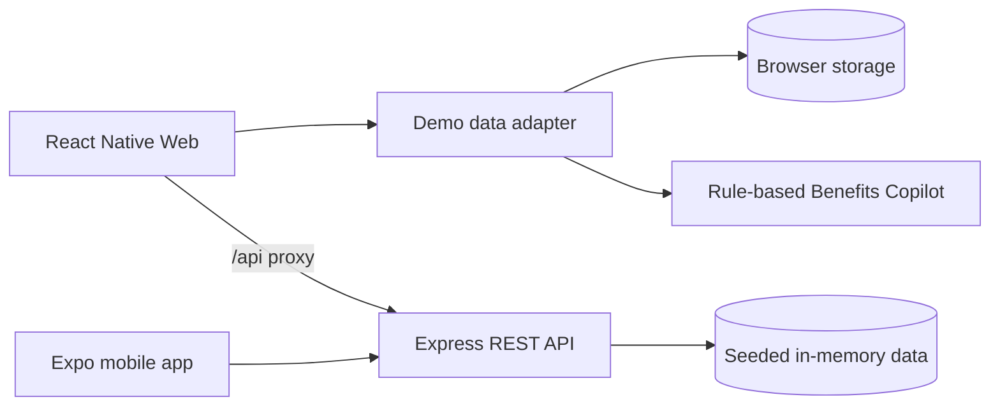

# PayPulse AI

PayPulse AI is a cross-platform employee benefits demo for earned wage access, expense claims, payroll details, and HR review workflows.

## Links

- **Live app:** [dist-three-kappa-22.vercel.app](https://dist-three-kappa-22.vercel.app)
- **API health:** [dist-three-kappa-22.vercel.app/api/health](https://dist-three-kappa-22.vercel.app/api/health)

## Features

- Daily wage accrual, an eligible advance limit, and a simulated transfer ledger.
- Expense claims with optional receipt attachments, allowance tracking, and manager review.
- Employee and HR manager views with payslips and in-app notifications.
- A rule-based Benefits Copilot for wage, payroll, expense, and allowance questions.

The demo opens as Alex Rivera (employee). Use **Switch: Mgr** in the header to view Sarah Chen's manager workspace.

## Tech stack

- **Client:** React Native, React Native Web, Expo SDK 52, TypeScript, React Navigation
- **API:** Node.js, Express, TypeScript, REST, JWT demo authentication
- **State:** AsyncStorage and browser storage for the web demo; seeded in-memory data in the API
- **Hosting:** Vercel; GitHub Actions checks the client and backend builds

## Architecture



The hosted web demo stores its workspace in the browser. The API uses sample in-memory data, which may reset when a serverless instance restarts.

## Run locally

Requirements: Node.js 20+ and npm.

```bash
npm ci
npm ci --prefix backend
npm ci --prefix mobile
npm run dev
```

This starts the API on port `4000` and Expo. Press `w` in the Expo terminal to open the web app. To start only the web app, run `npm run start:web` and open `http://localhost:3000`.

Local API health check: `http://localhost:4000/api/health`.

## Build

```bash
npm run typecheck
npm run build:backend
npm run build:web
```

## Demo scope

All data is sample data. Wage advances and reimbursements are simulations; no real payroll or banking accounts are connected and no money moves. The Benefits Copilot uses rules and project data, not a hosted language model.
