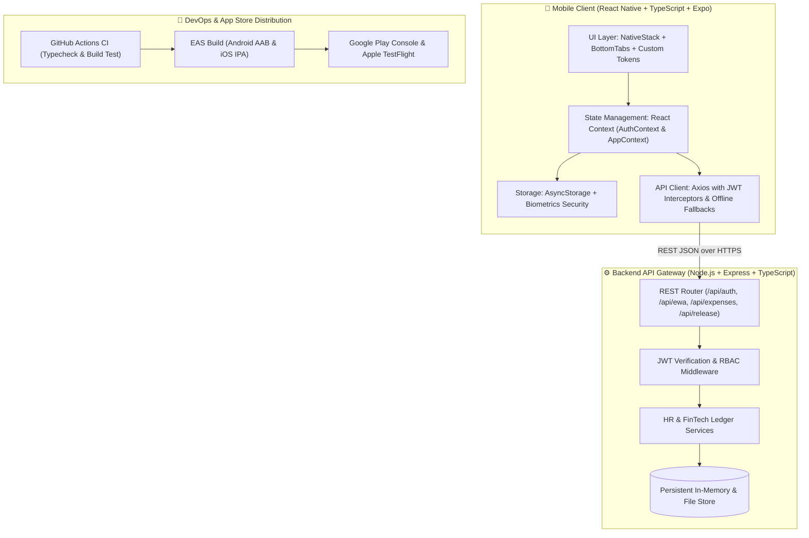

# ⚡ PayPulse AI — Enterprise HR & FinTech Mobile Platform

[](https://reactnative.dev/)
[](https://expo.dev/)
[](https://www.typescriptlang.org/)
[](https://nodejs.org/)
[](https://taiga.io/)
[](https://github.com/)

> **Targeted Candidate Portfolio Project** tailored specifically for the **Mobile App Developer Intern** role at **Heftin AI**.  
> Demonstrates the complete mobile engineering lifecycle: **Design → Build → Integrate → Test → Release → Improve**.

---

## 🌟 Why This Project Wins for Heftin AI

Heftin AI is revolutionizing how people and organizations interact with **HR Tech, Education (EdTech), and Finance (FinTech)**. **PayPulse AI** directly reflects this mission:

1. **FinTech (Earned Wage Access / EWA)**:
   - Eliminates employee payday liquidity crunches through real-time accrued wage calculation and instant RTP/ACH wage advance disbursements at 0% interest.
2. **HR Tech & EdTech Continuous Learning Stipends**:
   - Manages corporate expense claims with receipt camera scanning and tracks employee annual learning allowances ($1,200 cap) with manager approval workflows.
3. **"What Happens After You Press Run" (Mobile DevOps & Store Release)**:
   - Configured with Expo Application Services (`eas.json`), automated RSA 2048-bit Android Keystore generation, Google Play Data Safety compliance, Apple App Store privacy declarations, and GitHub Actions CI.
4. **Cross-Platform Knowledge**:
   - Implemented in **React Native & TypeScript** with a companion architectural RFC and equivalent **Dart / Flutter** implementation benchmarks.

---

## 🏗️ System Architecture



---

## 📱 Key Features

### 1. Earned Wage Access (EWA) Pulse Engine
- **Accrual Computation**: Computes exact daily accrued wages: `(Monthly Salary / 30) * Days Elapsed`.
- **Company Liquidity Guardrail**: Enforces a 50% max withdrawal limit to safeguard employee net take-home pay.
- **Instant Disbursement**: Supports Instant ACH/RTP simulation with tactile haptic feedback (`expo-haptics`) and real-time ledger updates.

### 2. HR Tech Expense & EdTech Learning Allowance
- **Receipt Capture**: Camera and gallery image picker integration (`expo-image-picker`) with receipt lightbox preview.
- **EdTech Stipend Meter**: Tracks annual company learning allowances ($1,200/yr) with visual progress indicators.
- **Manager Review System**: 1-click Approve / Reject actions for HR Managers with instant employee push notification dispatches.

### 3. In-App Notification Center & Payslip Breakdown
- **Real-Time Push Alerts**: Instant notification triggers for wage advances, claim approvals, and payroll releases.
- **Payslip Ledger Sheet**: Detailed modal breakdown of Gross Salary, Federal Tax deductions, Insurance, Provident Fund, and EWA advance deductions.

### 4. Demo Role Switcher
- Instant toggle between **Alex Rivera (Employee)** and **Sarah Chen (HR & Finance Manager)** directly from the top header or login screen for rapid review during technical interviews.

---

## 🚀 Quick Start Guide

### Prerequisites
- **Node.js**: v18+ (tested on Node.js v20 & v26)
- **npm**: v10+

### Option A: 1-Click Launch (Recommended)
Simply double-click `start-all.bat` on Windows, or run:
```bash
npm run dev
```
This concurrently starts:
- 🚀 **REST API Server** at `http://localhost:4000`
- 📱 **Expo Metro Bundler** for iOS, Android, and Web

### Option B: Run Services Independently

#### 1. Backend Server
```bash
cd backend
npm install
npm run dev
```
*Health Check: Visit `http://localhost:4000/api/health`*

#### 2. Mobile Client
```bash
cd mobile
npm install
npm start
```
- Press `w` to open in browser (Web preview).
- Press `a` to run on Android emulator or scan QR code via Expo Go app on your physical device.
- Press `i` to run on iOS Simulator (macOS).

---

## 🧪 Verification & Quality Checks

Run the automated test suite across backend and mobile:
```bash
npm run test
```
- Compiles Backend TypeScript (`tsc`).
- Executes strict mobile TypeScript validation (`npx tsc --noEmit`).

---

## 📦 Mobile Release Engineering ("After You Press Run")

### 1. Android Keystore Generation
Generate a cryptographically secure 2048-bit RSA upload key for Google Play Console:
```powershell
# Windows PowerShell:
powershell -ExecutionPolicy Bypass -File scripts/generate-keystore.ps1

# macOS / Linux:
chmod +x scripts/generate-keystore.sh && ./scripts/generate-keystore.sh
```

### 2. Expo Application Services (EAS Build)
Configured in `mobile/eas.json`:
```bash
# Build Android App Bundle (.aab) for Google Play:
eas build --platform android --profile production

# Build iOS Archive (.ipa) for Apple TestFlight:
eas build --platform ios --profile production
```

### 3. Store Submission & Governance
- [Google Play & App Store Release Guide](docs/APP_STORE_RELEASE_GUIDE.md): Staged rollout procedures, Data Safety declarations, and App Privacy Nutrition Labels.
- [Taiga Scrum Board & Agile Epics](docs/TAIGA_SCRUM_BOARD.md): User stories `#TG-101` through `#TG-105` tracked across two-week sprints.
- [React Native vs Flutter Architectural RFC](docs/REACT_NATIVE_VS_FLUTTER_RFC.md): Technical comparison of Fabric / TurboModules JSI vs Flutter Dart / Impeller engine.

---

## 📄 Resume Bullet Points (Copy & Paste Ready)

Include this project under **Experience** or **Featured Projects** on your resume:

- **Mobile Software Engineer (Portfolio Project) — PayPulse AI (HR-Tech & FinTech)**
  - *Architected and shipped a cross-platform mobile application using **React Native, TypeScript, and Expo SDK 52**, integrating with an **Express/Node.js REST API** to deliver Earned Wage Access (EWA) and corporate expense reimbursements.*
  - *Engineered a real-time wage accrual engine and secure checkout flow with JWT token lifecycle management, biometric lock simulation, and offline-first cache synchronization via AsyncStorage.*
  - *Implemented end-to-end mobile release engineering: configured **EAS build pipelines (`eas.json`)** for Android AAB and iOS IPA artifacts, established automated Android Keystore signing workflows, and authored App Store & Google Play privacy compliance audits.*
  - *Constructed **GitHub Actions CI/CD** workflows for automated linting, type-checking, and unit test suites; structured project deliverables across Agile sprints tracked via Taiga and Git commit conventions.*

---

## 🤝 Project Structure

```
├── backend/
│   ├── src/
│   │   ├── data/db.ts              # Typed persistent database models & seeded records
│   │   ├── middleware/auth.ts      # JWT authentication & RBAC middleware
│   │   ├── routes/
│   │   │   ├── auth.routes.ts      # Authentication & demo role switching
│   │   │   ├── ewa.routes.ts       # FinTech wage accrual & advance disburse
│   │   │   ├── expense.routes.ts   # HR expense claims & manager review
│   │   │   ├── notification.routes.ts
│   │   │   ├── payslip.routes.ts   # Payroll ledger calculations
│   │   │   └── release.routes.ts   # App version check & changelog API
│   │   └── server.ts               # Express entrypoint with request logger
│   └── package.json
│
├── mobile/
│   ├── src/
│   │   ├── api/                    # Axios REST client with offline fallback
│   │   ├── components/             # Reusable UI (WageCard, ExpenseItem, Modals)
│   │   ├── context/                # AuthContext & AppContext providers
│   │   ├── navigation/             # Bottom Tabs & Native Stack Navigator
│   │   ├── screens/                # Dashboard, EWA, Expenses, Alerts, Profile
│   │   ├── theme/                  # Design tokens & color palettes
│   │   └── types/                  # Shared TypeScript definitions
│   ├── app.json                    # Expo config (Bundle ID, permissions, icons)
│   ├── eas.json                    # EAS build profiles (Preview, Production AAB/IPA)
│   └── package.json
│
├── docs/
│   ├── APP_STORE_RELEASE_GUIDE.md   # Google Play & App Store publishing checklist
│   ├── TAIGA_SCRUM_BOARD.md        # Taiga Agile epics & user stories
│   └── REACT_NATIVE_VS_FLUTTER_RFC.md # Architecture comparison & Dart companion code
│
├── scripts/
│   ├── generate-keystore.ps1       # Automated Android keystore generation (Windows)
│   └── generate-keystore.sh        # Automated Android keystore generation (Unix)
│
├── .github/workflows/
│   └── mobile-ci.yml               # Automated GitHub Actions CI workflow
├── start-all.bat                   # 1-click Windows dev launcher
├── start-all.sh                    # 1-click Unix dev launcher
└── package.json                    # Unified monorepo runner
```
