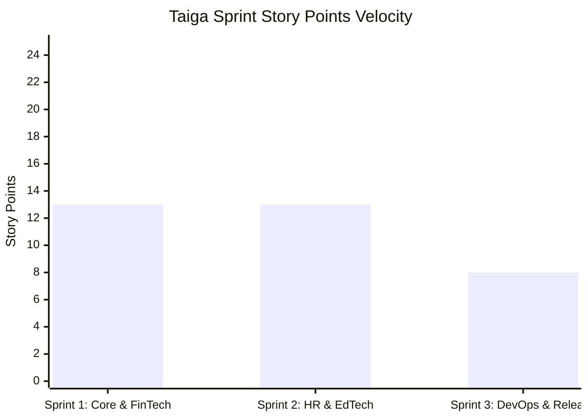

# PayPulse AI — Taiga Scrum & Agile Project Tracking

**Tool:** Taiga.io / Git Integration  
**Methodology:** Agile Scrum (2-Week Sprints)  
**Project Slug:** `heftin-paypulse-mobile`  
**Git Commit Convention:** `type(scope): message [#TG-ID]` (e.g. `feat(ewa): implement instant advance modal [#TG-102]`)

---

## 1. Epics & User Stories

### Epic 1: Mobile Core Infrastructure & Security (`#TG-EPIC-01`)
* **User Story #TG-101**: *Cross-Platform App Shell & JWT Authentication*
  - **As an** employee or HR manager,
  - **I want to** authenticate securely with JWT and biometric unlock,
  - **So that** my sensitive payroll and banking records remain confidential.
  - **Points**: 5 | **Status**: Closed (Sprint 1)
  - **Acceptance Criteria**:
    - [x] JWT token stored securely in AsyncStorage/SecureStore.
    - [x] Automatic 401 retry interceptor.
    - [x] Biometric Face ID toggle simulation.

### Epic 2: FinTech Earned Wage Access Engine (`#TG-EPIC-02`)
* **User Story #TG-102**: *Real-Time Accrued Wage Meter & Instant Advance*
  - **As an** employee,
  - **I want to** view my daily accrued earnings and request an advance with 0% interest,
  - **So that** I have emergency liquidity prior to the end-of-month payroll cycle.
  - **Points**: 8 | **Status**: Closed (Sprint 1)
  - **Acceptance Criteria**:
    - [x] Accrual formula computed: `(Monthly / 30) * DaysElapsed`.
    - [x] 50% liquidity limit enforcement.
    - [x] Instant ACH disbursement transaction recorded with tactile haptics.

### Epic 3: HR Tech Expense & EdTech Learning Allowance (`#TG-EPIC-03`)
* **User Story #TG-103**: *Receipt Scanning & Multi-Category Claim Filing*
  - **As an** employee,
  - **I want to** submit business expenses and EdTech learning course receipts,
  - **So that** I can utilize my $1,200 annual learning perk.
  - **Points**: 8 | **Status**: Closed (Sprint 2)
  - **Acceptance Criteria**:
    - [x] Camera / Image Picker integration for invoice photos.
    - [x] Visual category tagging (EdTech, Travel, Hardware, Meals).
    - [x] Annual EdTech allowance utilization progress bar.

* **User Story #TG-104**: *Manager Review & One-Click Authorization*
  - **As an** HR manager,
  - **I want to** review pending claims with receipt lightbox previews,
  - **So that** I can approve or reject claims in under 10 seconds.
  - **Points**: 5 | **Status**: Closed (Sprint 2)
  - **Acceptance Criteria**:
    - [x] Manager role toggling on mobile header.
    - [x] Instant state mutation on Approve / Reject.
    - [x] Automatic notification sent to the employee.

### Epic 4: DevOps, Release Engineering & Store Publishing (`#TG-EPIC-04`)
* **User Story #TG-105**: *EAS Build Pipeline & Store Signing Automation*
  - **As a** mobile release intern at Heftin AI,
  - **I want to** automate Android keystore signing and EAS production builds,
  - **So that** the team can ship high-quality `.aab` and `.ipa` artifacts reliably.
  - **Points**: 5 | **Status**: Closed (Sprint 3)
  - **Acceptance Criteria**:
    - [x] `eas.json` profiles defined for internal preview and production app-bundle.
    - [x] PowerShell & Shell scripts for automated keystore generation.
    - [x] GitHub Actions CI pipeline executing TypeScript checks and build validations.

---

## 2. Sprint Velocity Chart

